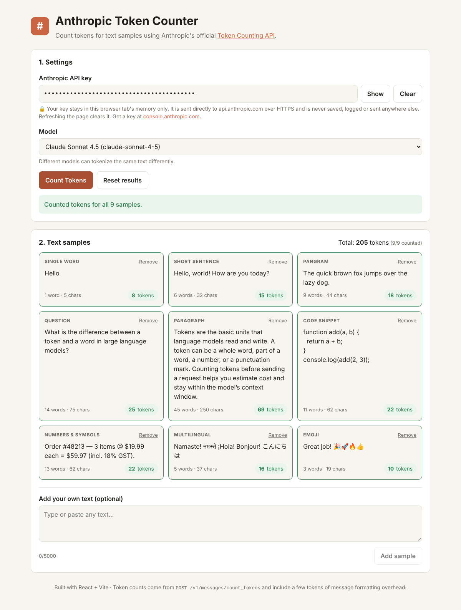

# Anthropic Token Counter (React)

A React + Vite web app that counts tokens for a set of predefined text samples using
Anthropic's official **Token Counting API**
(`POST https://api.anthropic.com/v1/messages/count_tokens`).

**Live demo:** _add your deployed link here_



## Features

- **API key input** – password field with Show/Hide and Clear; validated before any request.
- **Predefined samples** – single word, sentences, paragraph, code, numbers, multilingual text, emoji.
- **Add your own text** – optional custom samples (can also be removed).
- **Model selector** – count tokens for different Claude models.
- **Count Tokens button** – sends requests (3 at a time) and shows each count next to its sample, plus a running total.
- **Loading states** – spinner on the button and on every card; Cancel button while counting.
- **Error handling** – clear messages for:
  - empty / badly formatted key (checked locally, no request sent)
  - invalid key (401) – stops all remaining requests immediately
  - no permission (403), unknown model (404), rate limit (429), server errors (5xx / 529)
  - network failures and 20-second timeouts
  - per-sample errors shown on the card that failed
- **Responsive & accessible** – works on mobile and desktop, dark mode, keyboard focus styles, ARIA live regions.

## API key security

- The key is **never hardcoded** – there is no key in the source code or in any `.env` file.
- It is kept **only in React state (memory)**. It is not written to `localStorage`,
  `sessionStorage`, cookies or the URL, and refreshing the page clears it.
- It is **never logged** (no `console.log` of the key or request headers).
- It is sent **only** to `https://api.anthropic.com` over HTTPS in the `x-api-key` header,
  with `credentials: 'omit'` and `cache: 'no-store'`.
- The input disables autocomplete / password-manager capture.

**Why the browser calls Anthropic directly:** the app has no backend, so it sends the
`anthropic-dangerous-direct-browser-access: true` header that Anthropic requires for browser
(CORS) requests. That header exists to warn you not to put **your own** secret key in front-end
code for other people to use. This app doesn't do that: each user types in **their own** key at
runtime and it never leaves their browser except to go to Anthropic. In a production app where
the site owner pays for the key, you would put a small server (proxy) in between instead.

## Tech stack

- React 19 (functional components and hooks)
- Vite (dev server and build)
- Plain CSS (no UI library)
- `fetch` for HTTP (no SDK needed)

## Project structure

```
src/
├── api/anthropic.js          # API call, timeout, error mapping, key format check
├── components/ApiKeyInput.jsx
├── components/SampleCard.jsx
├── data/samples.js           # predefined text samples + model list
├── App.jsx                   # state, Count Tokens flow, layout
├── main.jsx
└── styles.css
```

## Setup and run locally

**Requirements:** [Node.js](https://nodejs.org) 20 or newer, and an Anthropic API key from
<https://console.anthropic.com/settings/keys>.

```bash
git clone <your-repo-url>
cd anthropic-token-counter
npm install
npm run dev
```

Open the URL shown in the terminal (usually <http://localhost:5173>), paste your API key, and
click **Count Tokens**.

Other commands:

```bash
npm run build     # production build into dist/
npm run preview   # serve the production build locally
npm run lint      # lint the source
```

## Deploy (Vercel)

1. Push this project to a GitHub repository.
2. On <https://vercel.com>, choose **Add New → Project**, import the repository.
3. Vercel detects Vite automatically (build command `npm run build`, output `dist`). Click **Deploy**.
4. No environment variables are needed – users enter their own key in the app.

## How it works

For each sample the app sends:

```json
{
  "model": "claude-sonnet-4-5",
  "messages": [{ "role": "user", "content": "<sample text>" }]
}
```

and displays the `input_tokens` value from the response, e.g. `{ "input_tokens": 14 }`.
The count includes a few tokens of message-formatting overhead, so even a one-word message
shows more than one token. Token counting is free to use, but has its own rate limits.

## References

- Token counting guide: <https://docs.anthropic.com/en/docs/build-with-claude/token-counting>
- API reference: <https://docs.anthropic.com/en/api/messages-count-tokens>
